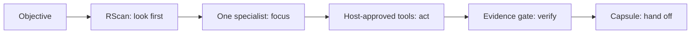

<div align="center">

# RCoder

### A repeatable engineering loop for the AI coding agent you already use.

**Recon → focus → memory → evidence → clean handoff.** No new model, no new editor, no permission bypass.

[](https://github.com/RidTheWann/RCoder-Skills/actions/workflows/quality.yml)
[](CHANGELOG.md)
[](LICENSE)
[](#compatibility)
[](#cross-platform-support)

**[Quick start](#quick-start)** · **[Proof by feature](#feature-proof-before--after)** · **[Command map](#command-map)** · **[Documentation](#documentation)**

</div>

---

## RCoder in 30 seconds

An agent with good tools can still work from guesses, forget your decisions, and say “done” without showing anything. RCoder adds the missing **process**:



Plain text, if Mermaid is not available: `objective → recon → focus → act → verify → hand off`.

RCoder is an **instruction and tooling layer**. It does not replace model inference, grant permissions, or turn a stored record into proof of model delivery.

### Choose your path

| You want to… | Start here |
|---|---|
| Install it and get one win in five minutes | [Quick start](#quick-start) |
| See what actually changes, feature by feature | [Proof by feature](#feature-proof-before--after) |
| Look at the measured model-behavior ablation | [Measured separately](#measured-model-behavior-separate-from-the-workflow) |
| Know what is and is not supported | [Compatibility](#compatibility) and [When not to use RCoder](#when-not-to-use-rcoder) |
| Contribute or audit the claims | [Verify it yourself](#verify-it-yourself) and [Documentation](#documentation) |

---

## How to read the evidence

Every card below uses the same shape: **Before** (the common unassisted pattern) → **After** (observed behavior) → **Proof** (a command, artifact, or recorded run) → **Limit** (what the evidence does *not* claim).

| Label | Meaning |
|---|---|
| **VERIFIED locally** | Observed in this repository on the POSIX development host, with the command shown. |
| **RECORDED** | Observed in a pinned run or test artifact in this repo; not re-run during this README rewrite. |
| **NOT VERIFIED** | Planned, simulated, or host-specific behavior without an observation. |

No number here is a universal guarantee. Model-behavior results are pinned to one model, host, and dataset, and are reported separately from integration evidence.

---

## Feature proof: before → after

### 1 · RScan — look before you edit

| Before | After |
|---|---|
| Agent opens files alphabetically, guesses the stack, and discovers the second caller too late. | A read-only, bounded scan reports stacks, entry points, a module graph, risk signals, and ranked development options **before** implementation. |

**Proof — VERIFIED locally:** `python3 skills/rcoder/scripts/rscan.py scan --root . --max-paths 20 --format json` returned `budget_mode: compact`, a dependency graph, and three ranked options on this repository (`FINISH_CHANGE` 90, `ONBOARD` 70, `REFACTOR` 50). `python3 scripts/test-rscan.py` → `PASS rscan: bounded scan, options, hook payloads, and idempotent installer`.

**Limit:** metadata-first by design; large source files are sampled, not dumped into context. It is a map, not a full semantic index of every line.

### 2 · Progressive specialists — load only what matters

| Before | After |
|---|---|
| Unrelated style guides are loaded; constraints disappear in the noise, or routing relies on trigger-word guessing. | One primary specialist plus at most two addendums, selected by **deliverable and risk**. Helpers such as RSaver and RFC stay supporting modules. |

**Proof — VERIFIED locally:** 73 reference files are present; `python3 scripts/validate-all` checked each module and enforces a floor of 50. The live ablation measured trigger precision **0.000 → 0.952** and recall **0.000 → 0.833** for one pinned setup; see [measured results](#measured-model-behavior-separate-from-the-workflow).

**Limit:** in the same pinned ablation, specialist exact-match was only **4 / 24 (16.7%)**. Better routing is not perfect routing.

### 3 · RFC Context Fabric — memory with provenance

| Before | After |
|---|---|
| Your earlier token-expiry decision disappears after compaction, or a stored config is mistaken for “the model remembers”. | Typed local items with source and confidence are assembled into a fresh, bounded payload **per request**; a canary is acknowledged against the raw response, and exports omit canaries. |

**Proof — VERIFIED locally:** `python3 scripts/test-context-fabric.py` → `Ran 10 tests … OK`, including explicit-time GC and missing-echo (no false delivery acknowledgement). `python3 scripts/test-opencode-native-e2e.py` → `Ran 5 tests … OK`: an installed OpenCode 2.4.2 host with a local mock provider captured a real outgoing request containing both RFC and Runtime markers with distinct provenance; enable/disable independence, retries, missing context, and Runtime startup failure were exercised. See [RFC design](docs/CONTEXT-FABRIC.md) and [OpenCode V2 evidence](docs/OPENCODE-V2-ADAPTER.md).

**Limit:** opt-in. Native request delivery is observed on **OpenCode 2.4.2**; Claude Code has a documented adapter path, but native loading is **NOT VERIFIED**. Each retry needs a new prompt identity. RFC write tools via MCP, encryption, sync, and vector retrieval are not implemented.

### 4 · RSaver — reduce context without losing the trail

| Before | After |
|---|---|
| Dump everything into the prompt, or truncate silently with no way to reconstruct what was removed. | Measure, budget, redact, and compact with **21 commands**; retained text stays verbatim and omitted ranges are recorded so reduction is recoverable. |

**Proof — VERIFIED locally:** `python3 skills/rcoder/scripts/rsaver.py --help` lists 21 commands; `python3 scripts/test-rsaver.py` → `PASS rsaver: bounded reduction, verbatim evidence, recoverability, verification, dedupe economics, project audit, redaction, and ledger`; `python3 skills/rcoder/scripts/rsaver.py measure LICENSE` → `estimate_v2=278` (heuristic). See [token economics](docs/TOKEN-ECONOMICS.md).

**Limit:** token figures are deterministic estimates for relative comparison, never provider billing. `redact` is lossy unless paired with its reversible vault; only omitted ranges from reduction are recoverable.

### 5 · RCoder Runtime — a claim is not an artifact

| Before | After |
|---|---|
| “Should be fixed” — no diff summary, no focused check, no inspectable criterion. | Optional Rust control plane with task contracts, guarded transitions, bounded artifact inspection, and an allowlisted report parser; the caller claim is stored separately from the verifier state. |

**Proof — VERIFIED locally:** `cargo test --manifest-path runtime/Cargo.toml --workspace` → **58 passing tests** (7 runtime binary + 51 runtime-core), including digest and mutation checks, cycle isolation, symlink refusal, and strict report parsing. See [Runtime architecture](docs/RUNTIME.md).

**Limit:** `artifact_verified` means a bounded artifact matched a strict report. It does **not** prove a command ran or that a claim is true. Runtime is optional and fail-open.

### 6 · MCP, CLI and host adapters — tooling with a boundary

| Before | After |
|---|---|
| Every editor needs bespoke wiring; a “loaded plugin” is treated as proof the agent used it; tool access is hard to bound. | A stdio MCP server exposes **39 tools (37 read-only)** behind a process-level `--root`; the `rcoder` CLI installs, verifies, doctors, lints, and packages; adapters carry context into the *actual* request. |

**Proof — VERIFIED locally:** `skills/rcoder/scripts/rcoder_mcp.py` registers 39 tools; only `rcoder_apply_verify` and `rcoder_learn` are mutating, so 37 are read-only. `python3 scripts/test-mcp.py` → `RCoder MCP server tests passed`; `python3 scripts/test-opencode-native-e2e.py` → 5 cases OK with a local mock provider and isolated host state. **RECORDED:** native activation is documented for OpenCode 1.19.6 (Agent Skill / RScan V1 hook) and 2.4.2 (V2 plugin request delivery). Claude Code is T0/T1 only, with native loading **NOT VERIFIED**. See [MCP reference](docs/MCP.md) and [compatibility evidence](docs/COMPATIBILITY.md).

**Limit:** 20 targets are catalogued with evidence tiers T0–T4. Installable is not the same as natively discovered; a plugin load is not activation. Other hosts stay NOT VERIFIED for native activation.

### 7 · Cross-platform setup — one canonical skill

| Before | After |
|---|---|
| POSIX-only assumptions: `python3` vs Windows Store stub, `.cmd` wrappers, hardcoded temp paths, symlink-only fixtures. | Thin portable resolvers in `platform_runtime.py` handle interpreters, host commands, isolated config, system temp, and a bounded copy fallback when symlinks fail. |

**Proof — VERIFIED locally:** `python3 scripts/test-cross-platform.py` → `Ran 13 tests … OK`, including Windows path round-trips, resolver safety, and CRLF-invariant digests. Native E2E passes on Linux.

**Limit:** native OpenCode execution on Windows, macOS, and Termux-native builds is **NOT VERIFIED**. Installer simulations do not prove host activation.

### 8 · Handoff — a capsule, not a chat scroll

| Before | After |
|---|---|
| You scroll the conversation to reconstruct what changed, what was checked, and what remains unknown. | A checkpoint records objective, constraints, verified facts, changes, checks, unknowns, and the next action; secrets are redacted. |

**Proof — RECORDED:** case `s10-api-migration` (add a required API field with a database column while older app versions stay deployed) selected five specialists, used 19 tool calls with 3 errors, and passed **4 / 4** rubric criteria. See [scenario](evals/scenarios/s10-api-migration.md), [case evidence](evals/runs/hy4-flash-openrouter-2026-11-19/evidence.json), and [handoff contract](docs/HANDOFF.md).

**Limit:** the retained run stores structured evidence, not a verbatim transcript. Three tool errors were recorded. One case is not a universal migration guarantee.

---

## Measured model behavior, separate from the workflow

The claim is narrow: **same model, same host, same prompts, same tools, same permissions, same fixture, same rubric — only RCoder differs.** It is not proof that RCoder makes a weak model strong.

<details>
<summary><strong>Live ablation: WITHOUT RCoder vs WITH RCoder</strong></summary>

| Metric | WITHOUT | WITH | Difference |
|---|---:|---:|---:|
| Trigger precision | 0.000 | 0.952 | +0.952 |
| Trigger recall | 0.000 | 0.833 | +0.833 |
| Trigger F1 | 0.000 | 0.889 | +0.889 |
| Trigger accuracy | 0.429 | 0.881 | +0.452 |
| Behavioral scenarios passed | 4 / 19 | 6 / 19 | +2 |
| Scenario rubric pass rate | 0.500 | 0.592 | +0.092 |

**Workload:** 42 trigger prompts and 19 behavioral scenarios, both arms. **Configuration:** OpenCode 1.19.6 with `openrouter/tencent/hy4-flash`; WITH arm used RCoder v1.11.0.

**Limits:** one pinned model/host/version/dataset; not a claim about v1.17.1; same-model rubric scoring; specialist exact-match 4/24 (16.7%). See [summary](evals/runs/hy4-flash-openrouter-2026-11-19/SUMMARY.md), [scores](evals/runs/hy4-flash-openrouter-2026-11-19/score-final.json), [evidence](evals/runs/hy4-flash-openrouter-2026-11-19/evidence.json), and [protocol](docs/LIVE-BENCHMARK.md).

</details>

---

## Quick start

> Three steps: **install → verify → ask your agent for engineering work.**

### 1 · Install

**Windows (PowerShell)**

```powershell
irm https://raw.githubusercontent.com/RidTheWann/RCoder-Skills/main/install.ps1 | iex
```

**Linux, macOS, WSL, Termux**

```sh
git clone https://github.com/RidTheWann/RCoder-Skills.git
cd RCoder-Skills
sh ./install.sh --target agents --scope project
```

**Node.js / npm** (requires Node.js 18.18+)

```sh
npx -y github:RidTheWann/RCoder-Skills
```

### 2 · Verify

Open a **new terminal** so the updated `PATH` is loaded:

```sh
rcoder doctor --json
```

`rcoder doctor --fix` repairs canonical launcher drift conservatively and reports `FIXED` or `SKIP`.

### 3 · Use it

> _“Inspect this repository, then implement the smallest safe fix for the failing test and show me the evidence.”_

Expected first signal: the agent runs a bounded recon command, names the specialist it chose, uses host-approved tools, and records a check instead of only asserting completion. Full installer options are in [Installation](#installation).

---

## Command map

| Goal | Command | Proof it backs |
|---|---|---|
| Map an unfamiliar repo | `python3 skills/rcoder/scripts/rscan.py scan --root . --format json` | [Feature 1](#1--rscan--look-before-you-edit) |
| Snapshot bounded context | `python3 skills/rcoder/scripts/context_snapshot.py . --max-paths 80` | [Feature 1](#1--rscan--look-before-you-edit) |
| Measure and reduce context | `python3 skills/rcoder/scripts/rsaver.py measure FILE` | [Feature 4](#4--rsaver--reduce-context-without-losing-the-trail) |
| Store / hydrate RFC context | `python3 skills/rcoder/scripts/context_fabric.py put --help` · `build --help` | [Feature 3](#3--rfc-context-fabric--memory-with-provenance) |
| Create and verify a task contract | `rcoder-runtime task create …` · `task verify --criterion AC-001 --enforce` | [Feature 5](#5--rcoder-runtime--a-claim-is-not-an-artifact) |
| Inspect the MCP server config | `python3 skills/rcoder/scripts/rcoder_mcp.py --print-config claude-code` | [Feature 6](#6--mcp-cli-and-host-adapters--tooling-with-a-boundary) |
| Check installation health | `rcoder doctor --json` | [Quick start](#quick-start) |

---

## Installation

Native Windows/POSIX installers do **not** require Node.js; the npm route requires Node.js 18.18+.

**Windows examples**

```powershell
& ([scriptblock]::Create((irm 'https://raw.githubusercontent.com/RidTheWann/RCoder-Skills/main/install.ps1'))) -Target qoder -Scope user
# -Mcp show | -Mcp install
```

**POSIX examples**

```sh
sh ./install.sh --host claude --scope user
sh ./install.sh --host gemini --scope project
sh ./install.sh --dry-run
sh ./install.sh --clean          # recommended for stale or broken installs
sh ./install.sh --uninstall
```

Every install initializes the local RFC store and installs the prebuilt Runtime binary from this project — **Rust is not required**. Use `--no-rfc` or `--no-runtime` to opt out; `--clean` forces a fresh bundle and regenerates managed state while keeping a timestamped backup.

**Claude Code plugin (marketplace)**

```sh
claude plugin marketplace add RidTheWann/RCoder-Skills
claude plugin install rcoder@rcoder-skills
# In a session: /plugin install rcoder --marketplace RidTheWann/RCoder-Skills
```

Add the **repository** (`owner/repo`), not a raw `marketplace.json` URL: Claude Code clones the repository to resolve the plugin source. The marketplace entry now uses a git source, so a URL-hosted catalog also resolves the plugin. Verify with `claude plugin list` and `claude mcp list`; the bundled server should report `✔ Connected` as `plugin:rcoder:rcoder`.

Launchers: `~/.local/bin/rcoder` on POSIX; `%USERPROFILE%\.rcoder\bin\rcoder.cmd` on Windows. The full target list lives in [docs/INSTALLATION-MATRIX.md](docs/INSTALLATION-MATRIX.md).

---

## Compatibility

Twenty installation targets are catalogued with evidence tiers. **Installable is not the same as natively active.**

| Tier | Meaning |
|---|---|
| T0 / T1 | Repository-level packaging and documented configuration. |
| T2 / T3 | Native discovery and injection observed on a specific host build. |
| T4 | Live model behavior observed under a pinned configuration. |

Native activation is observed only on **OpenCode**: 1.19.6 for Agent Skill discovery / RScan V1 hook, and 2.4.2 for V2 plugin request delivery. **Claude Code and every other host stay NOT VERIFIED** for native activation. See [docs/COMPATIBILITY.md](docs/COMPATIBILITY.md).

### Cross-platform support

| Concern | POSIX (Linux, macOS, WSL, Termux) | Windows |
|---|---|---|
| Python | `python3`, then `python`, with health check | Health check plus `py -3`; Store stub rejected |
| Node | `node` via `PATH` | `node.exe` via `PATHEXT` |
| Host command | Absolute path | Absolute path; `.cmd`/`.bat` wrapped with `cmd.exe /c` |
| Isolated config | `XDG_*`, `HOME`, `PWD` | `APPDATA`, `LOCALAPPDATA`, `USERPROFILE`, `TEMP` |
| Fixture links | Symlink preferred | Symlink with bounded copy fallback |

**VERIFIED locally:** POSIX development host. **NOT VERIFIED:** native OpenCode execution on Windows, macOS, and Termux-native builds.

---

## When not to use RCoder

Be honest about the boundaries — these are deliberate non-goals:

- You need an agent to bypass host approvals or gain new permissions. RCoder never does this.
- You need guaranteed model quality or universal benchmark wins. The measured ablation is one pinned setup.
- You need a sandbox, secret store, or encrypted/vector memory. Hooks are lexical guardrails, not a sandbox; RFC is local and opt-in.
- You need proven native activation outside the observed OpenCode builds. Claude Code and all other hosts are NOT VERIFIED.
- You need provider billing-grade token counts. RSaver figures are deterministic estimates.
- You need `artifact_verified` to mean “the command definitely ran”. It only means an allowlisted artifact matched a strict report.

---

## Security and execution boundaries

- **A skill is not authorization.** Security testing requires written scope; otherwise stay passive and local.
- **Host permissions remain authoritative.** No approval bypass.
- **Paths are confined.** MCP rejects traversal and escaping symlinks; Runtime rejects symlinked state directories.
- **Evidence is untrusted data.** Source strings are never executed as commands.
- **Canaries prove delivery only with raw-response acknowledgement.** A store or digest is not model memory.
- **Secrets never enter records or exports.** Env allowlists and redaction are mandatory.
- **Unverified stays unverified.** Missing checks, unknown host behavior, and unsupported claims are labeled.

See [SECURITY.md](SECURITY.md), [MCP security](docs/MCP.md), and [hooks limits](docs/HOOKS.md).

---

## Common questions

**Do I need Rust?** No. The installer ships a prebuilt Runtime binary for the host platform and initializes the RFC store automatically. Manual Rust builds remain available for contributors; both subsystems are fail-open and can be skipped with `--no-runtime` / `--no-rfc`.

**Do I need a paid model?** No. The E2E regression uses a local mock provider.

**Does `artifact_verified` mean tests really ran?** It means a bounded artifact matched an allowlisted report; it does not prove command execution or truth of a claim.

**Is Windows/macOS supported?** Portable code paths and unit tests exist, but native activation on those OSes is NOT VERIFIED here.

**Why does `cargo fmt` fail on my Termux image?** A rustup proxy may lack a default toolchain. Use `rustfmt --edition 2024 --check <sources>`; the source contract is unchanged.

**Does a plugin load prove activation?** No. Only observed request injection does.

---

## Verify it yourself

```sh
# Repository contract (routing, manifests, installers, evaluation data)
python3 scripts/validate-all

# Rust Runtime
cargo test --manifest-path runtime/Cargo.toml --workspace
rustfmt --edition 2024 --check runtime/crates/runtime-core/src/*.rs \
  runtime/apps/rcoder-runtime/src/main.rs

# Host, RFC, MCP and cross-platform regressions
python3 scripts/test-runtime-bootstrap.py
python3 scripts/test-runtime-task-host.py
python3 scripts/test-context-fabric.py
python3 scripts/test-context-fabric-host.py
python3 scripts/test-opencode-host.py
python3 scripts/test-cross-platform.py
python3 scripts/test-mcp.py
node scripts/test-opencode-v2-plugin.mjs
node scripts/test-opencode-plugin-host-state.mjs

# Native OpenCode request capture (local mock provider)
python3 scripts/test-opencode-native-e2e.py

# Packaging
python3 scripts/package
python3 scripts/check-dist.py
```

**Observed while writing this README (POSIX host):** `validate-all` → `4648 checks`, PASS; `test-rscan.py` PASS; `test-rsaver.py` PASS; `test-context-fabric.py` → 10 tests OK; `test-mcp.py` PASS; `test-cross-platform.py` → 13 tests OK; `test-opencode-native-e2e.py` → 5 tests OK; `cargo test … --workspace` → 58 tests PASS. **Recorded, not re-run here:** the ablation numbers above. GitHub Actions for the latest local changes remains **NOT VERIFIED** unless the workflow is observed.

---

## Documentation

**Start here**

- [Execution kernel](skills/rcoder/SKILL.md) · [Architecture](docs/ARCHITECTURE.md) · [Handoff contract](docs/HANDOFF.md) · [V2 contract](docs/V2-CONTRACT.md)

**Features**

- [MCP reference](docs/MCP.md) · [Modern MCP adapter](docs/MCP-MODERN.md) · [Runtime](docs/RUNTIME.md)
- [Context Fabric](docs/CONTEXT-FABRIC.md) · [Context drift](docs/CONTEXT-DRIFT.md) · [Token economics](docs/TOKEN-ECONOMICS.md) · [Billing and crosscheck](docs/BILLING-AND-CROSSCHECK.md)
- [Hooks](docs/HOOKS.md) · [RScan hooks](docs/RSCAN-HOOKS.md) · [Plugin integration matrix](docs/PLUGIN-INTEGRATION-MATRIX.md)

**Compatibility and evidence**

- [Compatibility evidence](docs/COMPATIBILITY.md) · [Installation matrix](docs/INSTALLATION-MATRIX.md) · [Environment discovery](docs/ENVIRONMENT.md)
- [OpenCode V2 evidence](docs/OPENCODE-V2-ADAPTER.md) · [MCP live test report](docs/RCODER-MCP-LIVE-TEST-REPORT.md) · [Installer security review](docs/INSTALLER-SECURITY-REVIEW.md)
- [Live benchmark protocol](docs/LIVE-BENCHMARK.md) · [Evaluation results](evals/results.md) · [Ablation protocol](evals/ABLATION-PROTOCOL.md) · [Evaluation independence](evals/EVALUATION-INDEPENDENCE.md) · [Multilingual policy](evals/MULTILINGUAL-POLICY.md)
- [Decisions](docs/DECISIONS.md) · [Changelog](CHANGELOG.md) · [Progress](docs/PROGRESS.md) · [Research log](docs/research-log.md) · [Research TODO](docs/RESEARCH-TODO.md)
- [v1.12 delivery](docs/V1.12-DELIVERY.md) · [v1.13 delivery](docs/V1.13-DELIVERY.md) · [v1.13 dev ledger](docs/V1.13-DEV-LEDGER.md)

**Project**

- [Contributing](CONTRIBUTING.md) · [Security](SECURITY.md) · [License](LICENSE)

---

## License

RCoder is released under the [MIT License](LICENSE).
